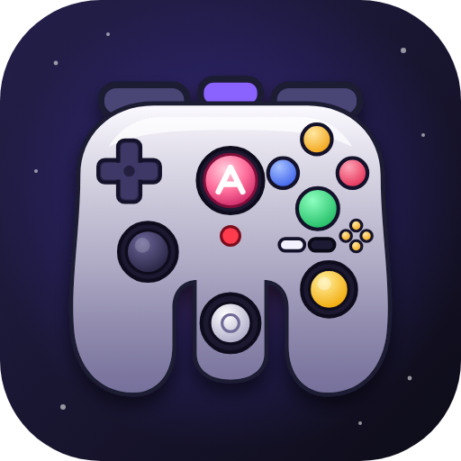

# O ícone do ARENA: o supercontrole (23/10/2026)

Pedido do Rafael: "o ícone do ARENA deve ser um controle que é uma junção de
todos os controles e formatos já existentes, um controle fundido com todos os
que existem de uma forma harmônica. Por exemplo, um controle daquele Xbox
Duke com 3 pernas para ter aquele analógico do Nintendo 64, com analógicos
direcionais apenas como o do PS2, ou seja, dois direcionais esquerdos como
cada um fica no controle e apenas um direito. O padrão de quatro botões de
ambos os controles continua, mas adicione aqueles botões especiais do
Nintendo 64 e GameCube além daqueles do próprio controle Duke do Xbox [...]
como ícone oficial do ARENA em todas as suas versões."



## O que cada parte herdou de qual controle

| Peça no desenho | De onde vem |
|---|---|
| Corpo de **três pontas** (duas empunhaduras e a ponta do meio) | Nintendo 64 |
| Massa larga e cheia, joia no centro, botões **preto e branco** | Xbox Duke (a joia virou a do ARENA, rosa, com um A) |
| **Dois analógicos à esquerda**: um na empunhadura (PS2/Xbox) e um na ponta do meio (o do N64) | PS2, Xbox e Nintendo 64 |
| **Um analógico só à direita**, amarelo | o C-stick do GameCube |
| Direcional (a cruz) | PS2, Xbox, GameCube |
| Quatro botões de sempre, nas cores do Xbox: **A verde, B vermelho, X azul, Y âmbar**; o A maior | Xbox, com o A grande do GameCube |
| Os **quatro C amarelos** e o **Start vermelho** | Nintendo 64 |
| O **Z roxo** em cima, entre o L e o R | GameCube |
| Gatilhos L e R | Xbox, GameCube e Nintendo 64 |

As cores dos botões e o rosa da joia são as da identidade do ARENA (a paleta
do ícone anterior: rosa, laranja, âmbar e verde sobre o azul-noite).

## Duas versões do mesmo desenho

- **Completa**, de 64 pixels para cima (o `.ico` de 64, 128 e 256, o site, o
  Chromebook, o Android e as imagens de apresentação): todas as peças da
  tabela, com brilho e sombra.
- **Simples**, de 16 a 48 pixels (aba do navegador, barra de tarefas, o `.ico`
  de 16, 24, 32 e 48, e o ícone pequeno do Android): só a silhueta de três
  pontas, os quatro botões grandes, os analógicos e a joia como círculos.
  Abaixo de uns 48 pixels os detalhes viram mancha, e foi o que a folha de
  contato mostrou.

## Onde o ícone aparece

| Versão | Arquivo | Onde |
|---|---|---|
| Windows (janela do ARENA) | `launcher/arena.ico`, `launcher/arena-icone-pequeno.svg` | O navegador em modo aplicativo usa o ícone da página: barra de tarefas e Alt+Tab |
| Windows (atalho) | `launcher/arena.ico` | `CRIAR-ATALHO.bat` cria o atalho `ARENA.lnk` na área de trabalho com este ícone |
| Tela do ARENA (todos os sistemas) | `launcher/arena-icone-pequeno.svg`, `arena-icone-64.png`, `arena-icone-192.png` | Aba, janela e o cabeçalho ao lado do nome |
| Chromebook e site (PWA) | `ferramentas/site/icone-192.png`, `icone-512.png`, `ARENA-CHROMEBOOK.html` | Quadrado de tela cheia, com o controle dentro da zona segura do "maskable" |
| Android | `docs/imagens/icone/android/mipmap-*` | `ferramentas/montar_android.py` copia para o APK: o ícone comum (48 a 192) e a frente do ícone adaptável (108 a 432, sem fundo) com o fundo `#1a1735` |
| Imagens e apresentações | `docs/imagens/icone/` | SVG (fonte), PNG de 512 e 1024, e o controle sozinho, sem fundo |
| Linux (`ARENA.desktop`) | (nenhum) | O `.desktop` só aceita ícone com **caminho absoluto** ou nome do tema, e o ARENA roda de qualquer pasta, então ele fica com `applications-games`. A janela do navegador mostra o supercontrole pelo `favicon` |

## Como refazer

O desenho mora em **um só lugar**, `ferramentas/gerar_icone.py` (SVG feito por
código, com as peças marcadas por `id`), e todos os arquivos acima saem dele:

```
servidor\python\python.exe ferramentas\gerar_icone.py
```

Precisa do Edge ou do Chrome (o Edge já vem no Windows) para desenhar o SVG
em PNG com transparência; o resto usa só a biblioteca padrão. Para mudar o
desenho, mexa no `gerar_icone.py` e rode de novo: o teste
`servidor/tests/test_icone.py` reprova se o SVG do repositório não for o que o
gerador produz hoje.

Para o Android, depois de gerar, monte o APK de novo
(`ferramentas\montar_android.py`).
